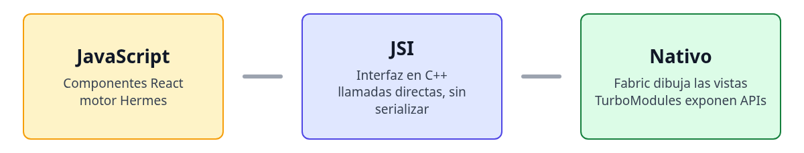

# React Native

## Introducción al entorno móvil moderno

* React Native es un **framework de Meta** para desarrollar **aplicaciones
móviles nativas** usando **JavaScript y React**.
* Permite construir para **Android** y **iOS** desde un mismo código base.
* Ofrece rendimiento nativo, acceso a APIs del sistema y una curva de
aprendizaje rápida para quienes ya dominan React.

> Es el puente entre el desarrollo web y el desarrollo móvil profesional.

---

# Rol e importancia de React Native

## Contexto y propósito

* Cada plataforma tiene su lenguaje nativo: **Kotlin** en Android y **Swift**
en iOS.
* Kotlin Multiplatform y el SDK de Swift para Android ya compilan para ambas.
* React Native hace lo mismo reutilizando React y el ecosistema de npm.
* Usa **componentes nativos reales**, no un navegador embebido.

\centering

{ width=75% }

> JSI conecta JavaScript con el código nativo sin serializar mensajes.

---

# Principios del entorno nativo

## Cómo se diferencia del desarrollo web

* En la web, React manipula el **DOM del navegador**.
* En móvil, React Native comunica su estructura al **motor nativo** de
Android/iOS.
* No existe HTML ni CSS; se usan **componentes nativos** y **estilos en objetos
JavaScript**.
* React Native combina la experiencia del desarrollador web con el rendimiento
nativo.

---

# Preparación del entorno

## Requisitos técnicos

* **Node.js** LTS
* **pnpm**
* Teléfono Android o iPhone con la app **Expo Go** instalada
* En iPhone, una cuenta gratuita de Expo iniciada en la app y en el terminal
* Conexión estable en la misma red Wi-Fi que el computador

> Descarga Expo Go:  
> [Play Store](https://play.google.com/store/apps/details?id=host.exp.exponent)  
> [App Store](https://apps.apple.com/app/expo-go/id982107779)

---

# Expo como entorno de desarrollo

## Ventajas y funcionamiento

* **Expo** simplifica la creación y ejecución de apps sin instalar SDKs
nativos.
* Permite crear, ejecutar y depurar en tiempo real.
* **Expo Go** es la app de aprendizaje. Corre solo proyectos del SDK actual.
* El comando `pnpm start` levanta un servidor y muestra un **código QR** en el
terminal.
* Basado en la documentación oficial:
[docs.expo.dev/get-started/set-up-your-environment](https://docs.expo.dev/get-started/set-up-your-environment/)

---

# Creación del proyecto

## Comandos iniciales

```bash
pnpm create expo-app <nombre-del-proyecto>
cd <nombre-del-proyecto>
pnpm start
```

* La plantilla por defecto trae Expo Router, TypeScript y pantallas de ejemplo
con rutas en `src/app`.
* `--template blank` genera solo `App.js`, para desarrollar un proyecto desde
cero.
* Escanea el **QR** del terminal con la app **Expo Go**.
* En iPhone, antes de `pnpm start`, inicia sesión con `pnpm expo login`.

---

# Estructura base del proyecto

## Archivos generados

* `src/app/index.tsx` — pantalla inicial. Cada archivo en `src/app` es una ruta.
* `src/app/_layout.tsx` — pestañas y tema que envuelven las pantallas.
* `src/components` — componentes de ejemplo.
* `app.json` — nombre, ícono y configuración de la app.
* `/assets` — ícono y pantalla de carga.
* `package.json` — scripts y dependencias.

> Esta estructura se crea automáticamente al iniciar el proyecto.

---

# Primer renderizado en React Native

## Contenido nuevo de `src/app/index.tsx`

```js
import { Text, View, StyleSheet } from "react-native";

export default function App() {
  return (
    <View style={styles.container}>
      <Text style={styles.title}>Hello React Native</Text>
      <Text style={styles.subtitle}>Running on my phone</Text>
    </View>
  );
}
```

* `View` reemplaza a `<div>` y `Text` a `<p>`.
* Todo el layout se basa en **componentes nativos**.

---

# Estilos en React Native

## Definición con `StyleSheet`

```js
const styles = StyleSheet.create({
  container: {
    flex: 1,
    justifyContent: "center",
    alignItems: "center",
  },
  title: { fontSize: 28 },
  subtitle: { fontSize: 18, opacity: 0.8, marginTop: 8 },
});
```

* Objetos JS, no CSS. `StyleSheet.create` valida y autocompleta.
* Los números son píxeles sin unidad, los porcentajes van como string `"50%"`.

---

# Imágenes

## Locales con `require` y remotas con URL

```js
<Image
  source={require("../../assets/images/icon.png")}
  style={styles.logo}
/>
<Image
  source={{ uri: "https://reactnative.dev/img/tiny_logo.png" }}
  style={styles.logo}
/>
```

* Importa `Image` desde `react-native` y agrega `logo: { width: 96, height: 96 }`.
* Las imágenes remotas necesitan ancho y alto explícitos.

---

# Navegación con Expo Router

## Enlace a otra pantalla

```js
import { Link } from "expo-router";

<Link href="/explore">Ir a Explore</Link>
```

* `href` apunta al archivo `src/app/explore.tsx`, que la plantilla ya trae.
* Cada archivo nuevo en `src/app` es una ruta, sin registrar nada.

---

# Sensores con expo-sensors

## Instalación

```bash
pnpm expo install expo-sensors
```

* `expo install` elige la versión compatible con el SDK del proyecto.
* Viene incluido en Expo Go, no requiere compilar nada nativo.

---

# Acelerómetro

## Lectura en tiempo real

```js
import { Accelerometer } from "expo-sensors";
import { useEffect, useState } from "react";

const [data, setData] = useState({ x: 0, y: 0, z: 0 });

useEffect(() => {
  const subscription = Accelerometer.addListener(setData);
  return () => subscription.remove();
}, []);
<Text>x: {data.x.toFixed(2)}</Text>
```

* El hook va dentro del componente y el `Text` dentro del `View`.

---

# Comparativa con React Web

## Elementos fundamentales

1. Render nativo en lugar de DOM.
2. Estilos declarativos en JS.
3. Layout con **Flexbox**.
4. Carga de imágenes con `require()` o URL.
5. Bibliotecas dedicadas para navegación y sensores.

> React Native mantiene la filosofía de React, pero en el entorno móvil.

---

# Resumen

1. React Native combina React y desarrollo móvil nativo.
2. Expo ofrece un entorno rápido y multiplataforma para iniciar.
3. Con pnpm el flujo es estable y simple.
4. Próxima clase: **estilos, Flexbox y NativeWind**.

---

# Recursos adicionales

* [Configuración oficial del entorno (Expo)](https://docs.expo.dev/get-started/set-up-your-environment/)
* [Documentación React Native](https://reactnative.dev/docs/getting-started)
* [Documentación Expo](https://docs.expo.dev/)
* [Expo Go en Play Store](https://play.google.com/store/apps/details?id=host.exp.exponent)
* [Expo Go en App Store](https://apps.apple.com/app/expo-go/id982107779)

---

# Preguntas y Discusión

¿Tienes dudas? ¡Hablemos!
