# Introducción

- Objetivo: reconocer los patrones de diseño que un usuario ya conoce y aplicarlos en una interfaz web.
- Base: las diez heurísticas de usabilidad de Jakob Nielsen y las leyes de UX derivadas de la psicología.

---

# Heurísticas de Nielsen

Diez reglas generales de usabilidad publicadas por Jakob Nielsen en 1994. Siguen siendo la referencia para evaluar interfaces.

1. Visibilidad del estado del sistema.
2. Relación entre el sistema y el mundo real.
3. Control y libertad del usuario.
4. Consistencia y estándares.
5. Prevención de errores.
6. Reconocer antes que recordar.
7. Flexibilidad y eficiencia de uso.
8. Diseño estético y minimalista.
9. Ayudar a reconocer y recuperar errores.
10. Ayuda y documentación.

---

# Affordance y señales

- Affordance: lo que un objeto permite hacer. Término de Don Norman.
- Señal: la pista visual que **comunica** esa posibilidad.
- Un botón debe parecer botón, un enlace debe parecer enlace.

\centering

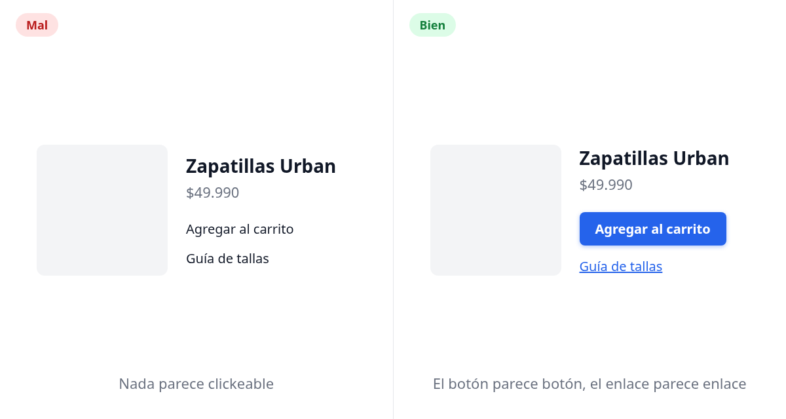{ width=64% }

---

# Contenido cortado

- Lo que se ve completo parece terminado. Es la **ilusión de completitud**.
- Una tarjeta cortada en el borde dice: "hay más, desliza".
- Aplica a carruseles, listas horizontales y al largo de la página.
- Los puntos indicadores no bastan en móvil. El corte sí.

\centering

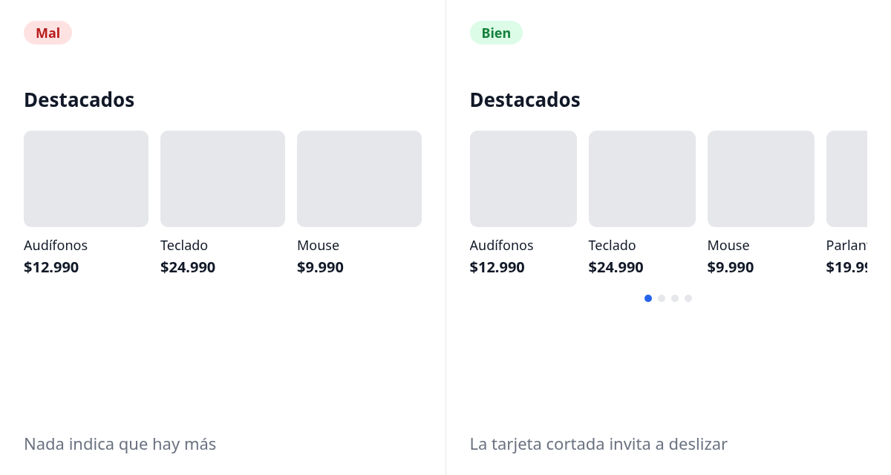{ width=64% }

---

# Ley de Jakob

- Los usuarios pasan la mayor parte del tiempo en **otros** sitios.
- Esperan que el tuyo funcione igual que los que ya conocen.
- Logo a la izquierda lleva al inicio. Centrado, seis veces menos éxito.
- Carrito arriba a la derecha. Lupa en el encabezado.

\centering

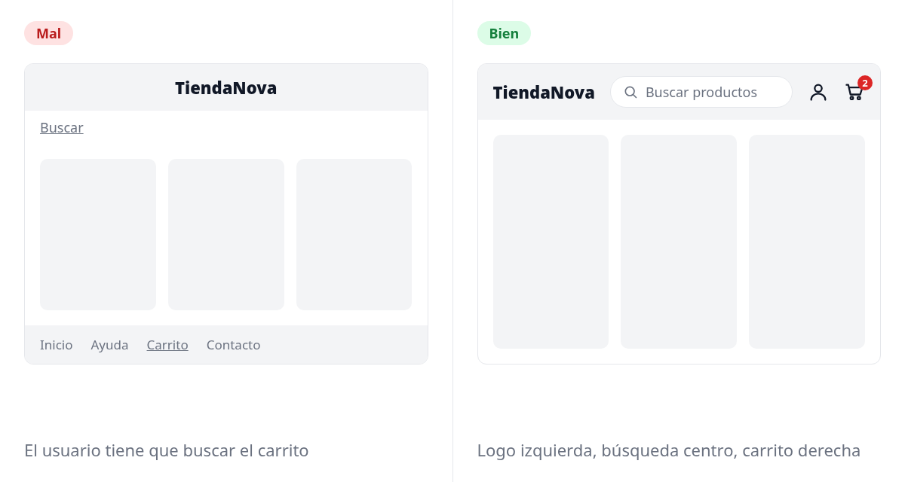{ width=64% }

---

# Consistencia interna

- Heurística 4: consistencia y estándares.
- Mismo elemento, mismo lugar, misma apariencia en todo el sitio.
- El carrito no cambia de esquina. El botón principal no cambia de estilo.
- Cada cambio obliga a volver a aprender la interfaz.

\centering

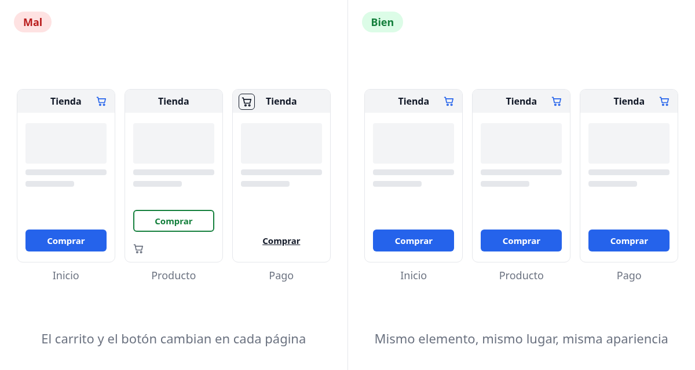{ width=64% }

---

# Jerarquía visual

- El ojo lee tamaño, contraste y espacio antes que palabras.
- Una pantalla, **una** acción principal.
- Lo secundario acompaña, no compite.
- Si todo destaca, nada destaca.

\centering

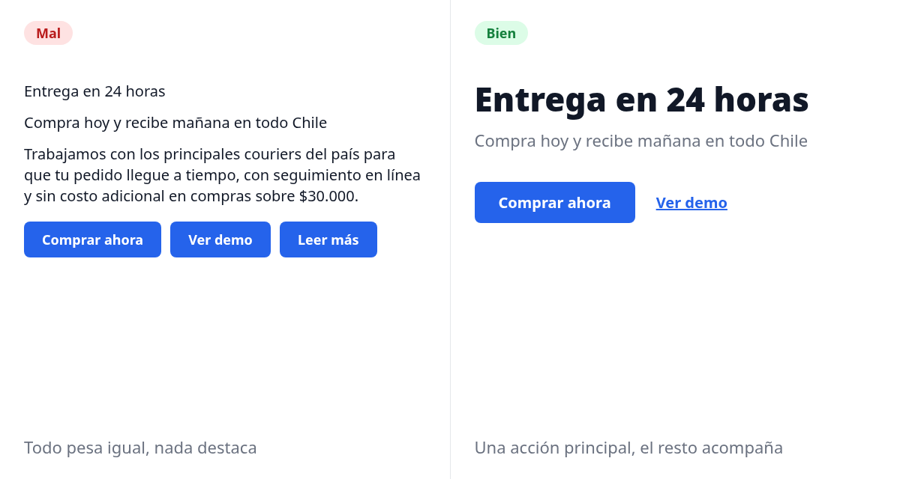{ width=64% }

---

# Patrón de lectura F

- El ojo recorre dos franjas horizontales y una vertical a la izquierda.
- Medido con seguimiento ocular por Nielsen Norman Group.
- Lo importante arriba y a la izquierda. Abajo a la derecha es lo menos visto.
- Las primeras palabras de cada línea y cada título cargan el mensaje.

\centering

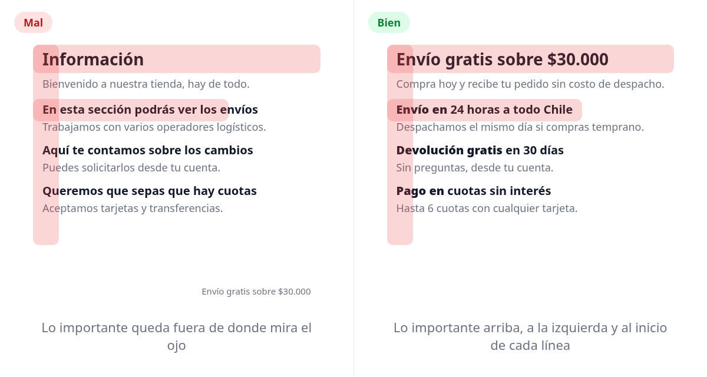{ width=64% }

---

# Ley de Fitts

- El tiempo para alcanzar un objetivo depende de su **tamaño** y **distancia**.
- Botones grandes, cerca de donde está el cursor o el pulgar.
- Apple recomienda 44 puntos de lado, Android pide 48 dp.
- Acciones relacionadas van juntas, no en esquinas opuestas.

\centering

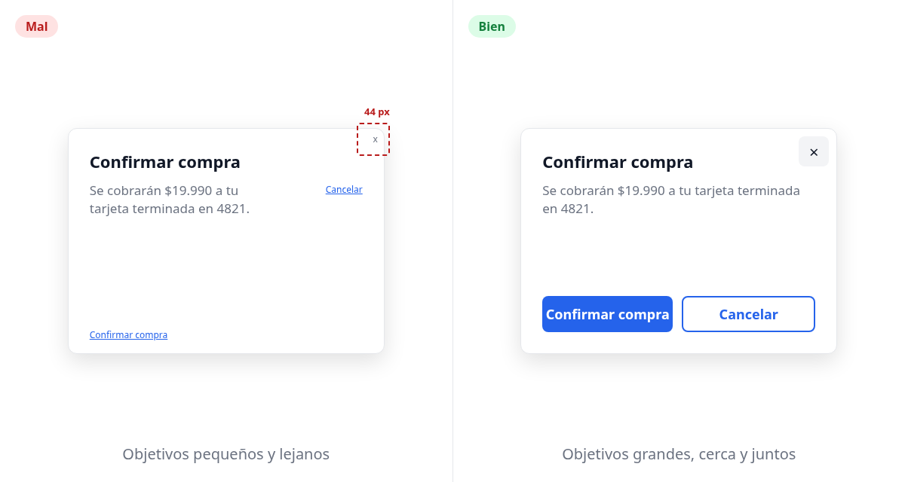{ width=64% }

---

# Ley de Hick

- Más opciones, más tiempo para decidir.
- Agrupar, priorizar y esconder lo avanzado.
- Revelación progresiva: mostrar el detalle solo cuando se pide.
- Un menú de catorce ítems no es completo, es paralizante.

\centering

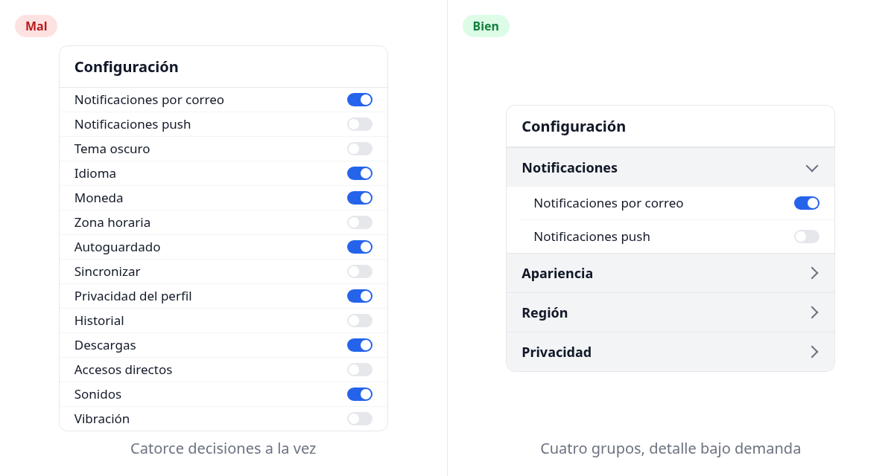{ width=64% }

---

# Ley de proximidad

- Principio de la psicología Gestalt: lo que está cerca se percibe como relacionado.
- Un fondo común agrupa sin necesidad de líneas. Es la ley de región común.
- Una etiqueta a igual distancia de dos campos es ambigua.
- El espaciado comunica estructura antes que cualquier texto.

\centering

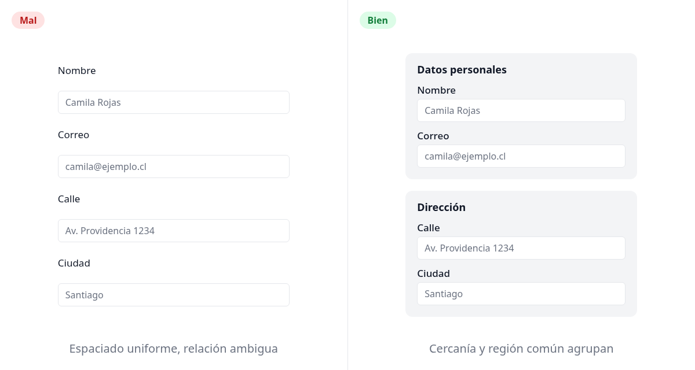{ width=64% }

---

# Ley de Miller

- La memoria de trabajo retiene pocos elementos a la vez.
- Fragmentar en bloques cortos: el RUT se escribe 12.345.678-5, no 123456785.
- Tarjetas en grupos de cuatro, teléfonos en grupos de cuatro o tres.
- Fragmentar no es limitar a siete ítems, es dar estructura.

\centering

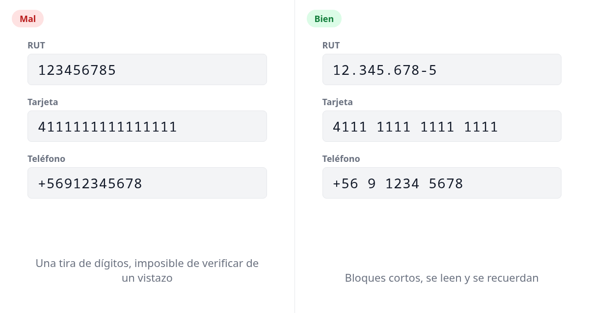{ width=64% }

---

# Visibilidad del estado

- Heurística 1: el sistema informa qué está pasando.
- Normal, hover, presionado, cargando y deshabilitado se ven distintos.
- 0,1 s se siente instantáneo, 1 s mantiene el flujo, 10 s pierde la atención.
- Un botón que no reacciona al clic genera un segundo clic.

\centering

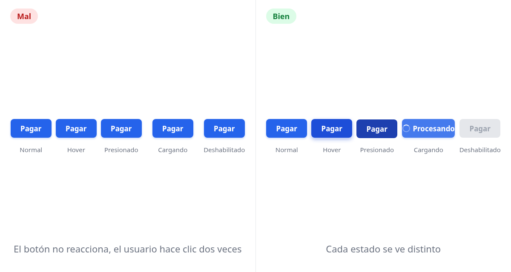{ width=64% }

---

# Spinner o esqueleto

- Menos de 1 s: no mostrar nada, un parpadeo molesta.
- Spinner para esperas cortas, de 2 a 10 s.
- Barra de progreso sobre 10 s y en descargas.
- Esqueleto solo al cargar una página completa. Anticipa la estructura.

\centering

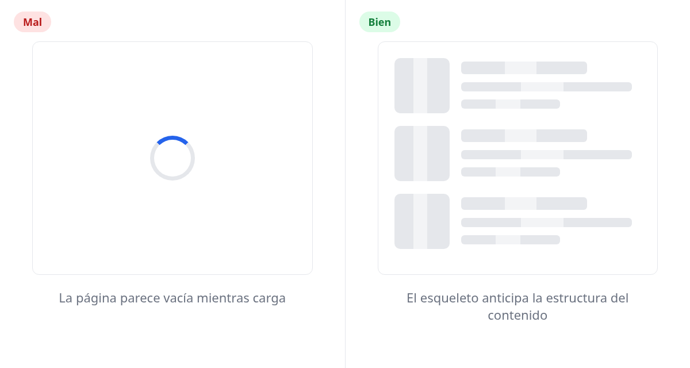{ width=64% }

---

# Estados vacíos

- Una lista vacía es la primera pantalla que ve un usuario nuevo.
- "0 resultados" no explica ni orienta.
- Decir por qué está vacío y ofrecer el siguiente paso.

\centering

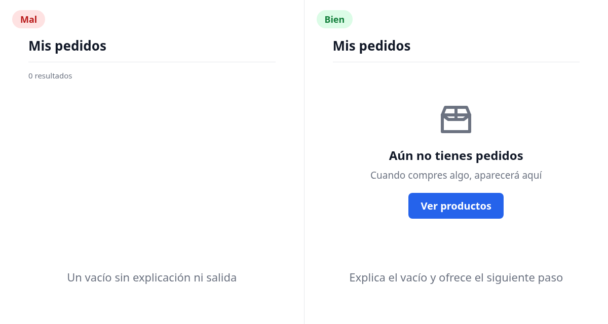{ width=64% }

---

# Formularios

- Etiqueta visible sobre el campo. El placeholder desaparece al escribir.
- Una sola columna. El ojo baja en línea recta.
- El error aparece junto al campo y dice cómo corregirlo.
- Tipo de input correcto: email, tel, number abren el teclado adecuado.

\centering

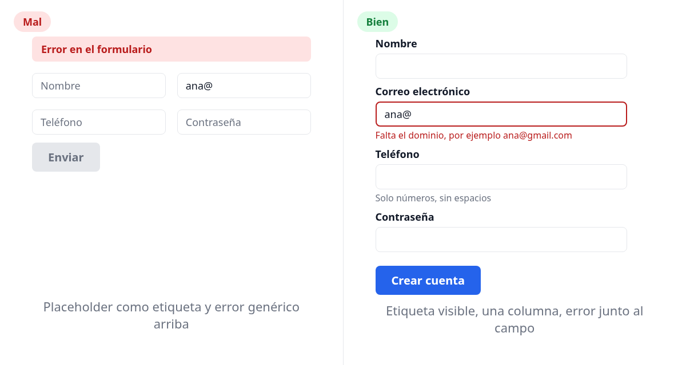{ width=64% }

---

# Progreso en pasos

- Un flujo largo sin indicador se siente infinito.
- Mostrar cuántos pasos hay y en cuál estamos. Un paso real por cada paso dibujado.
- Cerca de la meta el usuario acelera. Conviene mostrar lo avanzado.
- Las tareas incompletas se recuerdan más, por eso funcionan las barras de progreso.

\centering

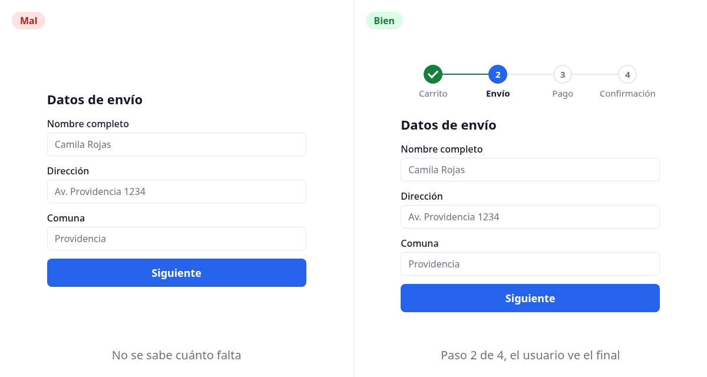{ width=64% }

---

# Zona del pulgar

- Casi la mitad de las personas usa el teléfono con una mano.
- El centro de la pantalla se toca rápido y preciso. Bordes y esquinas cuestan más.
- Barra inferior de 3 a 5 destinos. Lo poco frecuente arriba.
- Encabezado fijo pequeño o ninguno, la pantalla es escasa.

\centering

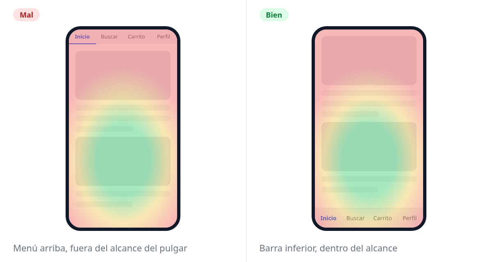{ width=56% }

---

# Posición serial

- Recordamos mejor el primer y el último elemento de una lista.
- Los ítems importantes del menú van en los extremos.
- Inicio al principio, Carrito o Perfil al final.
- El medio es para lo secundario.

\centering

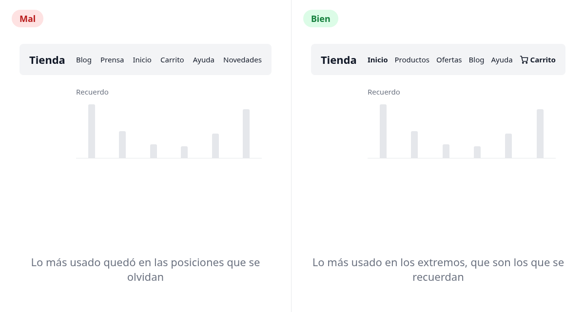{ width=64% }

---

# Efecto estético

- Lo que se ve ordenado se percibe como más fácil de usar.
- El usuario perdona errores menores en una interfaz cuidada.
- Riesgo: el orden visual esconde problemas reales de usabilidad.
- Primero que funcione, después que se vea bien, nunca al revés.

\centering

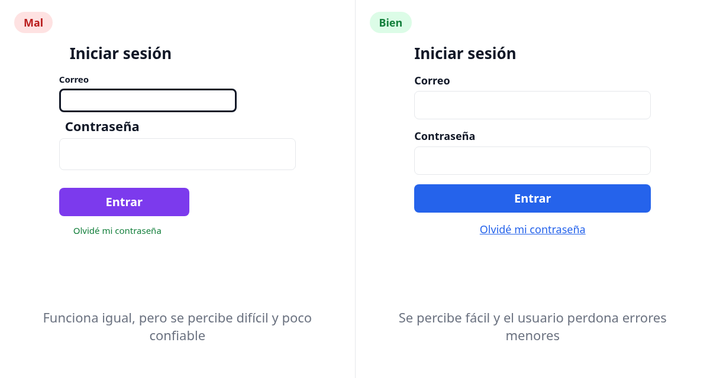{ width=64% }

---

# Accesibilidad

- WCAG: pautas de accesibilidad web publicadas por el W3C.
- Contraste mínimo 4,5 a 1 entre texto y fondo.
- El color nunca es la única señal. Icono o texto acompañan.
- El foco del teclado siempre visible.

\centering

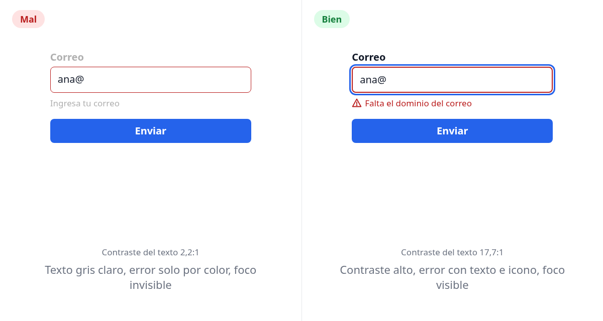{ width=64% }

---

# Patrones engañosos

- Avergonzar al que rechaza: "No, prefiero pagar más".
- Costos colados: casillas premarcadas, cargos al final.
- Fácil de entrar, difícil de salir.
- Funcionan a corto plazo y destruyen la confianza.

\centering

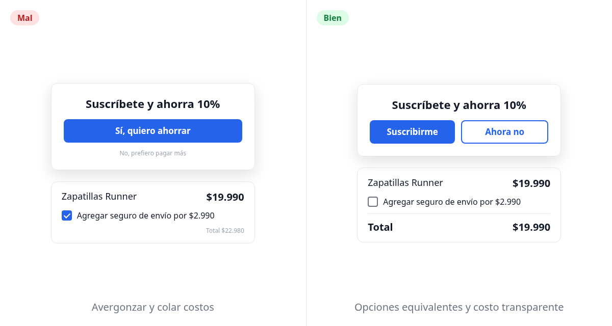{ width=64% }

---

# Resumen

1. El usuario trae hábitos de otros sitios. Respetarlos.
2. Cada elemento comunica qué hace con su apariencia y posición.
3. Mostrar siempre el estado: cargando, vacío, error, progreso.
4. Menos opciones y más estructura. Agrupar por cercanía.
5. Convencer con claridad, nunca con engaño.

---

# Recursos adicionales

- [Laws of UX][laws]
- [10 Usability Heuristics - Nielsen Norman Group][heuristics]
- [Baymard Institute - E-commerce UX research][baymard]
- [Deceptive Patterns][deceptive]

[laws]: https://lawsofux.com/
[heuristics]: https://www.nngroup.com/articles/ten-usability-heuristics/
[baymard]: https://baymard.com/blog
[deceptive]: https://www.deceptive.design/

---

# Preguntas y Discusión

¿Tienes dudas? ¡Hablemos!
